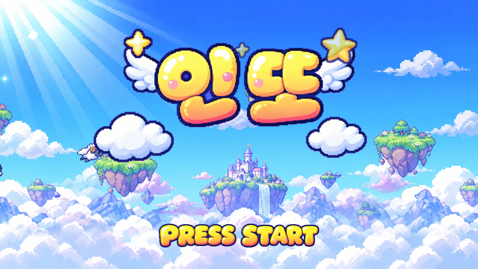
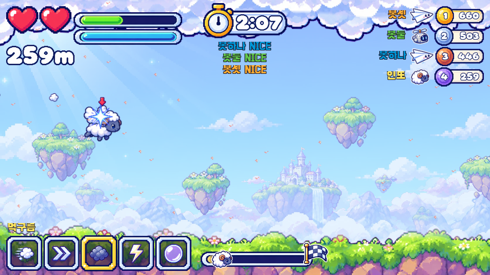
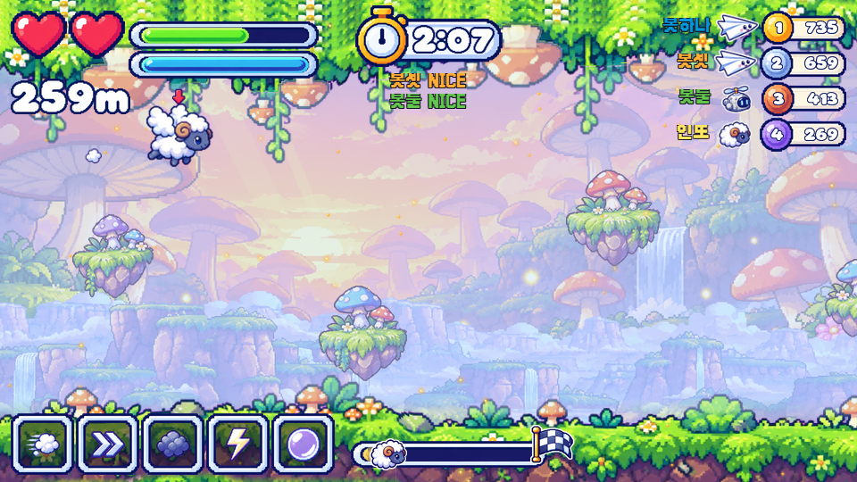
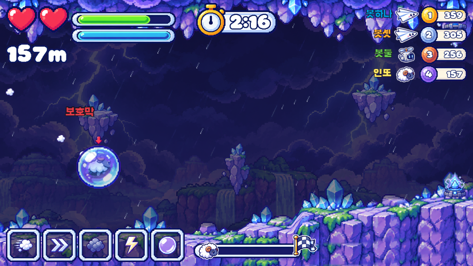
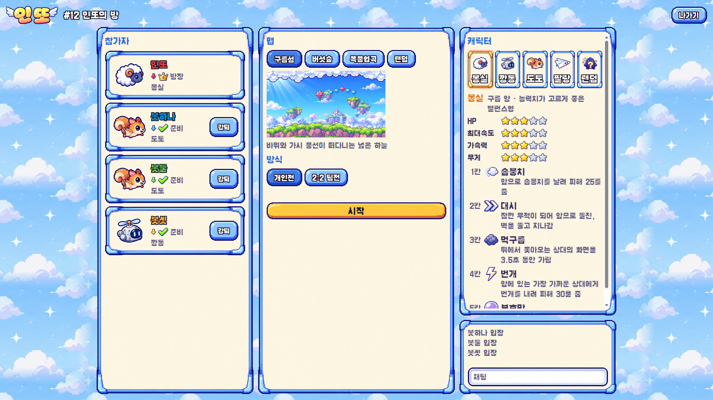
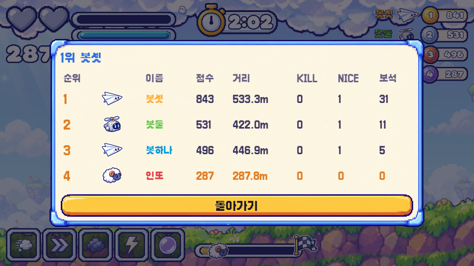

# 인또

최대 4명이 브라우저에서 함께 즐기는 횡스크롤 비행 레이스.
2분 30초 동안 지형과 장애물을 피해 날며 거리와 보석 점수를 겨루는 게임.



## 화면

| 구름섬 | 버섯숲 | 폭풍협곡 |
| --- | --- | --- |
|  |  |  |

| 방 | 결과 |
| --- | --- |
|  |  |

## 게임 방식

- 방에 2~4명이 모이면 시작. 빈자리는 방장이 봇으로 채움.
- 개인전과 2:2 팀전. 팀전은 4명일 때만 가능.
- 점수는 날아간 거리 1m당 1점과 보석 점수의 합. 파란 보석 10점, 드물게 나오는 빨간 보석 50점.
- 개인전은 점수 순으로 순위 결정, 팀전은 팀원 점수의 합으로 승패 결정.
- 생명은 2개. 땅이나 천장에 부딪히거나 HP가 바닥나면 생명 1개 감소.
- HP는 시간이 지날수록 감소하고 고기를 먹으면 회복.
- X를 누르는 동안 최고 속도로 가속. 가속 게이지가 가득 차면 6초 동안 쓸 수 있고, X를 떼고 있으면 12초에 다시 가득 참. 남은 만큼은 바로 사용 가능.
- 깃털을 모으면 기본 속도 증가, 최대 10개.
- 생명을 모두 잃으면 탈락하고 그 자리에서 기록 종료. 이후 유령으로 계속 날거나 다른 플레이어 관전.
- 사람이 모두 탈락하고 남은 봇이 모두 사람보다 앞서 있으면 그 자리에서 경기 종료. 팀전은 남은 봇이 모두 이기는 팀일 때만 종료.

### 기술

- 필드의 기술 아이콘을 먹으면 기술 하나를 들고, 한 번 쓰면 사라짐.
- 캐릭터마다 기술 5칸. 1칸 공격기, 2칸 대시, 3·4칸 고유기, 5칸 보호막. 어느 칸이 나올지는 아이콘마다 무작위.
- 기술에 맞은 상대가 3초 안에 생명을 잃으면 KILL.
- 좁은 목을 대시 없이 지나가면 NICE.

### 조작

| 키 | 동작 |
| --- | --- |
| 좌클릭 · ↑ | 누르면 상승, 떼면 하강 |
| X | 누르면 가속, 가속 게이지 소모 |
| 우클릭 · Z | 획득한 기술 사용 |
| Enter | 채팅 |
| M | 소리 켜기·끄기 |

### 캐릭터

| 캐릭터 | 특징 | 공격기 · 고유기 |
| --- | --- | --- |
| 몽실 · 구름 양 | 능력치가 고르게 좋은 밸런스형 | 솜뭉치, 먹구름, 번개 |
| 깡동 · 깡통 로봇 | 튼튼하지만 무거워 느림 | 너트 연사, 자가수리, 기름 |
| 도토 · 날다람쥐 | 가볍고 날렵한 기동형 | 도토리 폭탄, 활공, 회오리 |
| 팔랑 · 종이비행기 | 가장 빠르지만 체력이 낮음 | 종이 표창, 납작 접기, 바람개비 |

방에서 랜덤을 고르면 경기마다 캐릭터를 무작위로 배정.

### 맵

| 맵 | 특징 |
| --- | --- |
| 구름섬 | 바위와 가시 풍선이 떠다니는 넓은 하늘 |
| 버섯숲 | 우거진 밀림과 함께 버섯이 가득한 정글 |
| 폭풍협곡 | 거센 바람이 불고 번개 기둥이 내리치는 협곡 |

지형은 경기마다 시드로 새로 생성. 방에서 랜덤을 고르면 세 맵 중 하나를 무작위로 선택.

## 기술 구성

- 서버: Node.js 24, Express, Socket.IO. 방과 준비, 경기 시간, 순위와 결과 판정.
- 브라우저: Canvas 2D, ES 모듈. 빌드 과정 없이 서버가 `public/`과 `shared/`를 그대로 제공.
- 공용 코드: 규칙, 캐릭터, 맵 생성, 비행 계산을 서버와 브라우저가 `shared/`의 같은 파일로 사용. 같은 시드로 양쪽에서 같은 맵 생성.
- 동기화: 각 브라우저가 자기 캐릭터를 계산하고 초당 20번 위치를 서버로 전송. 다른 플레이어 위치는 조금 늦춰 보간해 부드럽게 표시.
- 서버 검증: 경과 시간 안에 낼 수 없는 거리, 서버가 기록하지 않은 KILL, 형식이 틀린 입력을 거부.
- 봇: 서버 안에서 Socket.IO 클라이언트로 접속해 사람과 같은 비행 계산으로 비행. 누르고 떼는 순서를 여러 갈래로 미리 날려 보고 가장 나은 길 선택.

## 실행

Node.js 24 이상 필요.

```bash
npm install
npm start
```

브라우저에서 `http://localhost:3000` 접속. 포트는 `PORT` 환경 변수로 변경.
`npm run dev`로 실행하면 서버 코드를 고칠 때마다 자동 재시작.

방장은 방 화면의 봇 추가 버튼으로 봇을 넣을 수 있음. 서버 밖에서 봇을 띄울 때는 다음 명령 사용.

```bash
node tools/bots.js 3
```

### Docker

```bash
docker build -t intto .
docker run -d -p 3000:3000 intto
```

`/healthz`로 서버 상태 확인.

## 폴더 구조

```
server/      게임 서버, 방과 경기 진행, 봇
shared/      서버와 브라우저가 함께 쓰는 규칙, 캐릭터, 맵 생성, 비행 계산
public/      브라우저 화면, 그림과 소리
tools/       그림·음악 변환 도구, 시험용 봇, 배포 스크립트
art_inbox/   그림과 배경음 원본
docs/        README 화면
```

## 그림·배경음·글꼴

- 그림: ChatGPT[^chatgpt]로 만든 원본을 `tools/art/`의 파이썬 도구로 잘라 `public/assets/`에 배치. 규격은 [tools/art/ASSET_SPEC.md](tools/art/ASSET_SPEC.md).
- 배경음: Treblo에서 받은 곡을 `tools/make_music.py`로 변환.
- 글꼴: [갈무리](https://galmuri.quiple.dev), Lee Minseo, SIL Open Font License 1.1.

[^chatgpt]: OpenAI의 대화형 AI 서비스. 이미지 생성으로 캐릭터, 배경, 아이콘 원본 제작.
